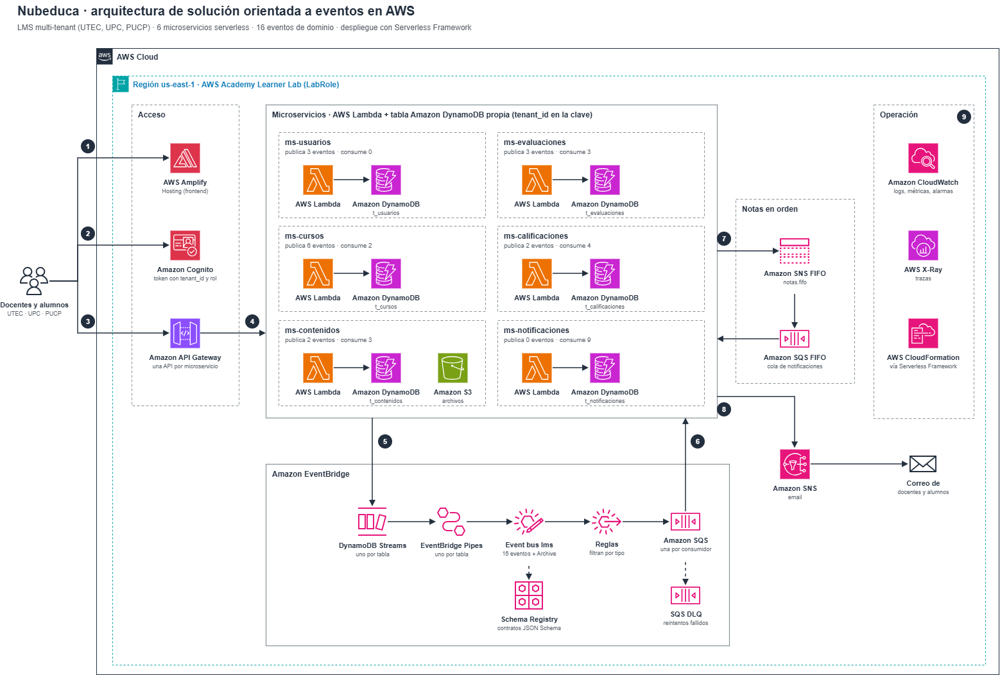

# ☁️ Nubeduca

**Tu institución educativa, en la nube.**

Nubeduca es un **LMS (Learning Management System) SaaS multi-tenant**: una sola plataforma que varias instituciones educativas usan al mismo tiempo, cada una con sus datos totalmente aislados. Proyecto Final del curso **CS2032 Cloud Computing (UTEC, 2026-2)**.

> **Para empezar:** lee la [arquitectura](#️-arquitectura), busca tus tareas en [Equipo y responsabilidades](#-equipo-y-responsabilidades) y trabaja siempre contra los contratos de [`nubeduca-contratos`](https://github.com/nubeduca/nubeduca-contratos).

---

## 🎯 Qué hace

| Usuario | Puede |
|---|---|
| 👩‍🏫 **Docente** | Crear cursos y matricular alumnos (CSV), publicar módulos con archivos, crear tareas, calificar y publicar notas, enviar anuncios |
| 🧑‍🎓 **Estudiante** | Ver sus cursos y módulos, descargar materiales, entregar tareas, ver sus notas y recibir avisos por email |
| 🛠️ **Administrador** | Gestionar la institución, sus periodos académicos y sus usuarios |
| 🏫 **Tenant** | Cada institución: `utec`, `upc`, `pucp` |

**Gate de la Fase 1 (lo que se demuestra con 2 tenants):** en el curso piloto, el docente publica contenido y una tarea, los alumnos entregan, el docente califica y cada alumno ve su nota y recibe el aviso.

---

## ✅ Requisitos del proyecto (enunciado del profesor)

La rúbrica manda: si el diseño choca con ella, gana la rúbrica.

| Requisito | Cómo lo cumplimos | Tareas |
|---|---|---|
| SaaS multi-tenant | `tenant_id` en el token, en cada evento y en la clave de cada tabla | AUTH-01, LIB-01 |
| Serverless | API Gateway + Lambda, DynamoDB, EventBridge, SQS y SNS | LIB-01, PLT-05 |
| Basada en eventos | Outbox con DynamoDB Streams + Pipes → EventBridge → una SQS por consumidor; SNS FIFO para notas | PLT-04, GATE-0 |
| Mínimo 5 microservicios protegidos | 6 microservicios, cada uno con su API Gateway y authorizer de Cognito | AUTH-01, PLT-05 |
| BD propia por microservicio | DynamoDB en los 6 (ADR-007) | — |
| Estructura JSON por microservicio | En el README de cada `nubeduca-ms-*` y en el informe | Tareas con seed, DOC-02 |
| 30.000 registros en 3 tenants | `poblar_datos.py` por microservicio, 10.000 por tenant | ACA-02, ACA-03, CON-02, EVA-01, EVA-02, ENG-01 |
| Uso de S3, SNS y SQS | S3 para archivos y entregas, SNS para notas (FIFO) y email, SQS por consumidor | CON-01, PLT-04, ENG-01 |
| Despliegue con Serverless Framework | Un `serverless.yml` por stack | PLT-01 a PLT-06 |
| Frontend en Amplify | Shell web y pantallas por módulo | FE-01, FE-02, FE-03 |
| Diagrama de arquitectura | draw.io con íconos AWS | DOC-01 |
| Demo con 2 tenants | Guion y video con UTEC y UPC | QA-01, DOC-03 |
| Informe y PowerPoint | Informe con enlaces a los repos y diseño de BD | DOC-02, DOC-03 |

---

## 🏗️ Arquitectura

*Diagrama editable: [`nubeduca-arquitectura.drawio`](https://github.com/nubeduca/.github/blob/main/nubeduca-arquitectura.drawio)*

### Cómo fluye una petición

1. El navegador carga el frontend desde **AWS Amplify Hosting**.
2. El usuario inicia sesión en **Amazon Cognito**. El token trae `tenant_id` y rol.
3. Cada llamada va a la **API Gateway** del microservicio dueño. El authorizer de Cognito valida el token, y la Lambda toma `tenant_id` del token, nunca del body.
4. La **Lambda** escribe en la tabla **DynamoDB** de su microservicio y, en la misma transacción, el evento (registro `EVENTO#`). Ningún microservicio lee la tabla de otro. Los archivos suben directo a **S3** con URL prefirmada.
5. **DynamoDB Streams** y **EventBridge Pipes** llevan cada evento al bus **`lms`**. **Schema Registry** guarda los contratos y **Archive** permite reprocesar.
6. Una **regla** por consumidor copia el evento a su cola **SQS** con **DLQ**. La Lambda consumidora lo procesa una sola vez (idempotente).
7. ms-calificaciones publica además las notas en **SNS FIFO** con grupo `tenant_id:course_id`, y llegan en orden a la cola **SQS FIFO** de ms-notificaciones.
8. ms-notificaciones avisa por **email** con Amazon SNS, según las preferencias del usuario.
9. **CloudWatch** y **X-Ray** observan todo. **Serverless Framework** despliega cada microservicio como un stack de CloudFormation.

### Principios

1. **Cada servicio es dueño de sus datos.** Nadie lee ni escribe la base de otro. Se integra por eventos o por su API.
2. **Eventos = hechos en pasado** (`submission.graded`). Los comandos son llamadas síncronas al servicio dueño, nunca mensajes en el bus.
3. **Coreografía por defecto.** Los servicios reaccionan a eventos sin conocerse entre sí.
4. **Transactional outbox.** El cambio y el evento se guardan en la misma transacción. Nunca "guardar y luego publicar".
5. **Consumidores idempotentes.** La entrega es at-least-once: cada consumidor registra el `eventId` y descarta duplicados.
6. **Orden solo donde importa** (notas): SNS FIFO → SQS FIFO. En el resto se descartan eventos con `aggregateVersion` vieja.
7. **Contratos versionados.** Un cambio incompatible es un tipo nuevo (`.v2`).
8. **Multi-tenant desde el día uno.** `tenant_id` va en el token, en cada evento y en la clave de partición.

### Decisiones tomadas (ADR)

| ADR | Decisión |
|---|---|
| ADR-001 | **6 microservicios desplegables**, cada uno agrupa varios dominios lógicos |
| ADR-002 | **Construir desde cero** (no envolver Moodle) |
| ADR-003 | **EventBridge + SQS / SNS** como broker de eventos |
| ADR-005 | **Pool:** los 3 tenants comparten tablas, con `tenant_id` en la clave |
| ADR-006 | **Lambda + API Gateway** para el cómputo |
| ADR-007 | **DynamoDB** en los 6 microservicios (sin VPC ni RDS) |

El documento completo de arquitectura de solución (contexto, mapa de capacidades vs. Moodle/Canvas/Blackboard, catálogo de 21 servicios, patrones, stack, riesgos y prueba de estrés) lo mantiene Dev 3.

---

## 🧩 Microservicios y eventos

Los 21 servicios lógicos del diseño se agrupan en **6 microservicios**, uno por repo `nubeduca-ms-*`. Cada uno tiene su API Gateway, sus Lambdas, su tabla DynamoDB y su seed de 30.000 registros.

| Microservicio | Servicios lógicos | `source` | Publica | Consume | Tareas |
|---|---|---|---|---|---|
| **ms-usuarios** | Tenant y Organización, Usuarios y Perfiles | `lms.users` | `tenant.created`, `term.started`, `user.provisioned` | — | ACA-01, ACA-02 |
| **ms-cursos** | Cursos y Secciones, Matrícula, Anuncios | `lms.courses` | `course.created`, `course.published`, `course.archived`, `enrollment.created`, `enrollment.dropped`, `announcement.published` | `term.started`, `user.provisioned` | ACA-03, ACA-04, COL-01 |
| **ms-contenidos** | Contenido y Módulos, Archivos y Media (S3) | `lms.content` | `file.scanned`, `module.published` | `course.created`, `enrollment.*` | CON-01, CON-02 |
| **ms-evaluaciones** | Tareas y Entregas | `lms.assessment` | `assignment.published`, `submission.submitted`, `submission.graded` | `enrollment.*`, `file.scanned` | EVA-01 |
| **ms-calificaciones** | Calificaciones, Auditoría de notas | `lms.grading` | `grade.changed`, `grade.posted` (bus + SNS FIFO) | `assignment.published`, `enrollment.*`, `submission.graded` | EVA-02, DAT-01 |
| **ms-notificaciones** | Notificaciones | — | — | `user.provisioned`, `course.published`, `enrollment.*`, `announcement.published`, `module.published`, `assignment.published`, `submission.submitted`, `grade.posted` | ENG-01 |

Los **16 eventos** del MVP siguen el formato `lms.<contexto>.<entidad>.<hecho>.v1` (por ejemplo `lms.content.file.scanned.v1`). Sus esquemas JSON, un ejemplo de cada uno y los contratos OpenAPI de los 6 microservicios están en [`nubeduca-contratos`](https://github.com/nubeduca/nubeduca-contratos). **Ningún microservicio publica un evento ni expone una ruta que no esté ahí.**

---

## 📦 Repositorios

| Repo | Contenido | Dueño | Estado |
|---|---|---|---|
| [`.github`](https://github.com/nubeduca/.github) | Este README y el diagrama de arquitectura | Dev 5 | 🟢 Activo |
| [`nubeduca-backlog`](https://github.com/nubeduca/nubeduca-backlog/issues) | Las 33 tareas como issues: fase, ola, dependencias y responsable | Dev 3 | 🟢 Activo |
| [`nubeduca-contratos`](https://github.com/nubeduca/nubeduca-contratos) | Catálogo de 16 eventos, JSON Schema, OpenAPI de los 6 microservicios y validación en CI | Dev 3 | 🟢 v1 publicada (ARQ-01) |
| [`nubeduca-infra`](https://github.com/nubeduca/nubeduca-infra) | Entorno local con LocalStack. Luego: stacks `base/`, `bus/` y `auth/` | Dev 1, 2 y 4 | 🟡 LocalStack listo |
| [`nubeduca-frontend`](https://github.com/nubeduca/nubeduca-frontend) | React + TypeScript + Vite, publicado en Amplify | Dev 6 | 🟡 Shell listo (FE-01) |
| `nubeduca-ms-usuarios` | Tenant, periodos, usuarios y perfiles | Dev 3 y 4 | ⚪ Por crear |
| [`nubeduca-ms-cursos`](https://github.com/nubeduca/nubeduca-ms-cursos) | Cursos, secciones, matrícula CSV y anuncios | Dev 3 y 4 | ⚪ Solo README |
| `nubeduca-ms-contenidos` | Archivos en S3 con antivirus, módulos e ítems | Dev 5 | ⚪ Por crear |
| [`nubeduca-ms-evaluaciones`](https://github.com/nubeduca/nubeduca-ms-evaluaciones) | Tareas y entregas | Dev 4 | ⚪ Solo README |
| [`nubeduca-ms-calificaciones`](https://github.com/nubeduca/nubeduca-ms-calificaciones) | Libro de notas, publicación por SNS FIFO y auditoría | Dev 4, 3 y 5 | 🟠 Base previa, falta alinearla a los contratos |
| `nubeduca-ms-notificaciones` | Consumidores SQS y email por SNS | Dev 6 | ⚪ Por crear |

---

## 👥 Equipo y responsabilidades

Las asignaciones son las de la **arquitectura de solución** (sección 9). Con 6 devs, cada persona cubre un dominio o una capa; los squads se forman cuando el equipo crezca. Las tareas viven como **issues** en [`nubeduca-backlog`](https://github.com/nubeduca/nubeduca-backlog/issues): cada issue indica su fase, su ola, de qué depende y cuándo está listo.

| Dev | Integrante | Área principal |
|---|---|---|
| **1** | Fabricio · [@cruz-eng](https://github.com/cruz-eng) | Plataforma AWS: stages, stack base, API Gateway, despliegue continuo, staging y producción |
| **2** | Mariano · [@MarianoUtec](https://github.com/MarianoUtec) | Monorepo y CI, bus de eventos, Cognito (AUTH-01) e informe final |
| **3** | Benjamin · [@btoroled](https://github.com/btoroled) | Arquitectura y contratos; dominio académico: tenant, cursos, matrícula y anuncios |
| **4** | Brando · [@Edinson695](https://github.com/Edinson695) | Entorno local (LocalStack), usuarios, tareas y entregas, calificaciones |
| **5** | Alexander · [@AIexander-lx](https://github.com/AIexander-lx) | Diagrama de arquitectura, plantilla de servicio, contenidos (S3 y módulos) y auditoría de notas |
| **6** | Guillermo · [@Guillermo-Heredia](https://github.com/Guillermo-Heredia) | Frontend en Amplify, notificaciones por email, PowerPoint y video de la demo |

### Tareas de cada integrante

| Dev | Fase 0 · Fundaciones | Fase 1 · MVP académico |
|---|---|---|
| **1 · Fabricio** | [PLT-01](https://github.com/nubeduca/nubeduca-backlog/issues/4) Cuenta AWS y stages · [PLT-03](https://github.com/nubeduca/nubeduca-backlog/issues/8) Stack base · [PLT-05](https://github.com/nubeduca/nubeduca-backlog/issues/15) API Gateway y borde · [PLT-06](https://github.com/nubeduca/nubeduca-backlog/issues/18) CD y alarmas · [GATE-0](https://github.com/nubeduca/nubeduca-backlog/issues/22) *(con Dev 2)* | [REL-01](https://github.com/nubeduca/nubeduca-backlog/issues/28) MVP en staging *(con Dev 2)* · [REL-02](https://github.com/nubeduca/nubeduca-backlog/issues/33) Producción y piloto *(con Dev 3)* · opcionales: [PERF-01](https://github.com/nubeduca/nubeduca-backlog/issues/26), [PERF-02](https://github.com/nubeduca/nubeduca-backlog/issues/30) |
| **2 · Mariano** | [PLT-02](https://github.com/nubeduca/nubeduca-backlog/issues/5) Monorepo y CI · [PLT-04](https://github.com/nubeduca/nubeduca-backlog/issues/14) Bus de eventos · [AUTH-01](https://github.com/nubeduca/nubeduca-backlog/issues/17) Cognito y tenant en el token · [GATE-0](https://github.com/nubeduca/nubeduca-backlog/issues/22) *(con Dev 1)* | [REL-01](https://github.com/nubeduca/nubeduca-backlog/issues/28) *(con Dev 1)* · [DOC-02](https://github.com/nubeduca/nubeduca-backlog/issues/29) **Informe final** · opcionales: [PERF-01](https://github.com/nubeduca/nubeduca-backlog/issues/26), [PERF-02](https://github.com/nubeduca/nubeduca-backlog/issues/30) |
| **3 · Benjamin** | [ARQ-01](https://github.com/nubeduca/nubeduca-backlog/issues/1) Catálogo de eventos · [LIB-01](https://github.com/nubeduca/nubeduca-backlog/issues/7) Plantilla de servicio *(con Dev 5)* | [ACA-01](https://github.com/nubeduca/nubeduca-backlog/issues/9) Tenant y organización · [ACA-03](https://github.com/nubeduca/nubeduca-backlog/issues/16) Cursos *(con Dev 4)* · [ACA-04](https://github.com/nubeduca/nubeduca-backlog/issues/19) Matrícula CSV · [COL-01](https://github.com/nubeduca/nubeduca-backlog/issues/23) Anuncios · [EVA-02](https://github.com/nubeduca/nubeduca-backlog/issues/27) Calificaciones *(con Dev 4)* · [REL-02](https://github.com/nubeduca/nubeduca-backlog/issues/33) *(con Dev 1)* |
| **4 · Brando** | [LOC-01](https://github.com/nubeduca/nubeduca-backlog/issues/3) Entorno local con LocalStack | [ACA-02](https://github.com/nubeduca/nubeduca-backlog/issues/10) Usuarios y perfiles · [ACA-03](https://github.com/nubeduca/nubeduca-backlog/issues/16) Cursos *(con Dev 3)* · [EVA-01](https://github.com/nubeduca/nubeduca-backlog/issues/24) Tareas y entregas · [EVA-02](https://github.com/nubeduca/nubeduca-backlog/issues/27) Calificaciones *(con Dev 3)* |
| **5 · Alexander** | [DOC-01](https://github.com/nubeduca/nubeduca-backlog/issues/6) **Diagrama de arquitectura** · [LIB-01](https://github.com/nubeduca/nubeduca-backlog/issues/7) Plantilla de servicio *(con Dev 3)* | [CON-01](https://github.com/nubeduca/nubeduca-backlog/issues/11) Archivos y media · [DAT-01](https://github.com/nubeduca/nubeduca-backlog/issues/12) Auditoría de notas · [CON-02](https://github.com/nubeduca/nubeduca-backlog/issues/20) Contenido y módulos |
| **6 · Guillermo** | [FE-01](https://github.com/nubeduca/nubeduca-backlog/issues/2) Shell web en Amplify | [ENG-01](https://github.com/nubeduca/nubeduca-backlog/issues/13) Notificaciones por email · [FE-02](https://github.com/nubeduca/nubeduca-backlog/issues/21) UI académica · [FE-03](https://github.com/nubeduca/nubeduca-backlog/issues/25) UI de tareas y notas · [DOC-03](https://github.com/nubeduca/nubeduca-backlog/issues/32) **PowerPoint, guion y video** |
| **Todos** | — | [QA-01](https://github.com/nubeduca/nubeduca-backlog/issues/31) E2E del curso piloto con 2 tenants |

**Ruta crítica:** ARQ-01 → LIB-01 → Tenant → Cursos → Matrícula → Tareas → Notas → staging → producción. Si una de estas tareas se atrasa, se suma un segundo dev en vez de apurar el resto.

**La Ola 3 es la más cargada** (7 tareas para 6 personas): Dev 5 toma DAT-01 después de CON-01. La Fase 1 no espera a GATE-0: arranca en la Ola 3, apenas está la plantilla de servicio.

---

## 📍 Estado actual

| Tarea | Responsable | Estado | Dónde |
|---|---|---|---|
| ARQ-01 Catálogo de eventos y OpenAPI | Dev 3 | 🟡 Publicado, falta la revisión de los 6 devs | [`nubeduca-contratos`](https://github.com/nubeduca/nubeduca-contratos) |
| LOC-01 Entorno local con LocalStack | Dev 4 | 🟢 Listo | [`nubeduca-infra/localstack`](https://github.com/nubeduca/nubeduca-infra/tree/main/localstack) |
| FE-01 Shell web | Dev 6 | 🟡 Shell listo, falta publicarlo en Amplify | [`nubeduca-frontend`](https://github.com/nubeduca/nubeduca-frontend) |
| DOC-01 Diagrama de arquitectura | Dev 5 | 🟢 Diagrama v1 subido a este repo | este repo |
| PLT-01, PLT-02, PLT-03, LIB-01 | Dev 1, 2, 3 y 5 | ⚪ Por empezar | — |

**Revisión de ARQ-01:** cada dev revisa lo suyo en el PR de `nubeduca-contratos` (la lista está en su README). Cuando los 6 aprueben, ARQ-01 queda cerrada y LIB-01 puede arrancar.

**Avances previos que se reutilizan:** `nubeduca-ms-calificaciones` ya tiene una base (`serverless.yml` y tabla) que hizo Mariano. Cuando esté la plantilla de LIB-01, se alinea a los contratos v1 (token de Cognito, camelCase y outbox) para EVA-02 y DAT-01.

---

## 🎯 Avance del 30% · sábado 14 de noviembre

La rúbrica le da **3 puntos** a la exposición virtual con el asesor y pide un **avance proporcional al 30%**.

**Propuesta (por confirmar con el grupo):** las **olas 1 y 2 completas** más **PLT-04 y PLT-05**, es decir 10 de las 33 tareas.

| Ola | Tareas |
|---|---|
| 1 | ARQ-01 Catálogo · LOC-01 LocalStack · PLT-01 Cuenta y stages · PLT-02 Monorepo y CI · FE-01 Shell en Amplify |
| 2 | DOC-01 Diagrama · LIB-01 Plantilla de servicio · PLT-03 Stack base |
| 3 | PLT-04 Bus de eventos · PLT-05 API Gateway y borde |

**Lo que vería el asesor:**
- Diagrama de arquitectura
- Catálogo de eventos y contratos OpenAPI
- Frontend publicado en Amplify con login simulado
- Un endpoint que responde desde Amplify por API Gateway → Lambda
- La plantilla con un servicio de ejemplo que publica y consume un evento (en local con LocalStack)

---

## 🚀 Despliegue e IaC

Toda la infraestructura se declara con **Serverless Framework v4**: un `serverless.yml` por stack y un `serverless-compose.yml` que despliega en paralelo lo independiente y en orden lo que depende de otro (**base → bus → auth → microservicios**).

| Stack | Qué crea | Repo |
|---|---|---|
| `infra/base` | Bucket de despliegue y parámetros SSM compartidos | `nubeduca-infra` |
| `infra/bus` | Bus `lms` de EventBridge, Schema Registry, Archive y SNS FIFO de notas | `nubeduca-infra` |
| `infra/auth` | User pool de Cognito con `tenant_id` y rol en el token | `nubeduca-infra` |
| Cada microservicio | API Gateway + Lambdas + tabla DynamoDB + sus reglas, colas SQS y DLQ de consumidor | `nubeduca-ms-*` |
| Frontend | Amplify Hosting publica cada merge a `main` | `nubeduca-frontend` |

| Tema | Decisión |
|---|---|
| Entornos | `dev`, `staging` y `prod` como stages de Serverless en el Learner Lab |
| Conexión entre stacks | Por outputs de CloudFormation leídos con `${servicio.Output}` en Compose; nadie copia ARNs a mano |
| Consumidores | Cada servicio declara en su propio stack la regla de EventBridge, su cola y su DLQ; el bus solo se crea en `infra/bus` |
| Pipeline | En cada PR: lint, tests, compatibilidad de esquemas y tests de contrato → `serverless deploy --stage dev`. Merge a `main` → `staging`. Producción con aprobación manual |
| CI | GitHub Actions con `SERVERLESS_LICENSE_KEY` como secreto |
| Eventos nuevos | Orden de despliegue: esquema en el registry → regla y cola del consumidor → productor |
| Liberación | Feature flags por tenant para abrir funciones solo al curso piloto |

> PLT-02 define si el código se junta en un monorepo (como propone la arquitectura, con `infra/`, `services/` y `web/`) o se mantiene un repo por microservicio, como está hoy.

---

## 📐 Reglas de trabajo

- **Un servicio, un equipo dueño; un tipo de evento, un solo productor.**
- Suscribirse a un evento no requiere pedir permiso: el contrato vive en el registry y el productor no puede romperlo.
- **Event storming por dominio** antes de cada fase del roadmap.
- **Toda decisión estructural queda como ADR** en el repositorio. Un PR que rompa uno de los principios de arquitectura necesita un ADR.
- **Definition of Done:** eventos documentados en AsyncAPI, test de contrato en CI, dashboard, alertas y runbook.
- Repos **públicos** dentro de la organización `nubeduca`.
- Cada tarea se trabaja desde su **issue**. El PR menciona el ID de la tarea (por ejemplo `CON-01`).
- **Ningún PR se mergea sin la revisión de otro dev.** Los contratos de eventos y la plantilla de servicio los aprueba Dev 3.
- **Python 3.13** + **Serverless Framework v4** con los stages `dev`, `staging` y `prod`.
- Rol IAM: `arn:aws:iam::${aws:accountId}:role/LabRole`. En el Learner Lab no se pueden crear roles.
- Tablas: `${sls:stage}-t_<nombre>`, con **`tenant_id` en la clave de partición**.
- Tenants: `utec`, `upc`, `pucp` · Roles: `STUDENT`, `TEACHER`, `ADMIN`.
- `tenant_id` y rol salen del **token de Cognito** (`custom:tenant_id`, `custom:role`), nunca de la ruta ni del body.
- Ids, rutas y campos en **inglés y camelCase**; textos para el usuario en español.
- Los eventos llevan **payload mínimo** (ids y lo que cambió), nada de nombres ni correos. Un archivo viaja como `fileId`.
- `poblar_datos.py` **no** escribe ítems `EVENTO#`, para no inundar el bus al cargar los 30.000 registros.
- Antes de desplegar en AWS, se prueba en local con [LocalStack](https://github.com/nubeduca/nubeduca-infra/tree/main/localstack).
- Cada microservicio incluye: `serverless.yml`, Lambdas, `poblar_datos.py` (30.000 registros, 10.000 por tenant), colección de Postman y README con la estructura JSON de sus tablas.

---

## 🗺️ Roadmap

Para el curso se entregan la **Fase 0** y la **Fase 1**. La prueba de estrés es un adicional y las Fases 2 a 4 quedan como roadmap.

| Fase | Contenido | Gate |
|---|---|---|
| **0 · Fundaciones** | Learner Lab, EventBridge + Schema Registry, SQS con DLQ, CI/CD, CloudWatch + X-Ray, Cognito, API Gateway, plantilla de servicio | Un servicio publica por outbox, otro consume de forma idempotente y la traza se ve de punta a punta |
| **1 · MVP académico** | Tenant, usuarios, cursos, matrícula CSV, contenido y módulos, archivos, tareas y entregas, calificaciones, anuncios, notificaciones y auditoría de notas | Contenido → tarea → entrega → nota → aviso, con 2 tenants |
| 2 · Evaluación y colaboración | Quizzes (QTI), rúbricas, LTI 1.3, calendario, foros, mensajería, app móvil | — |
| 3 · Engagement y analítica | Progreso, certificados, LRS (xAPI), reportes, búsqueda | — |
| 4 · Ecosistema | SCORM / cmi5, Common Cartridge, webhooks públicos, pagos | — |
