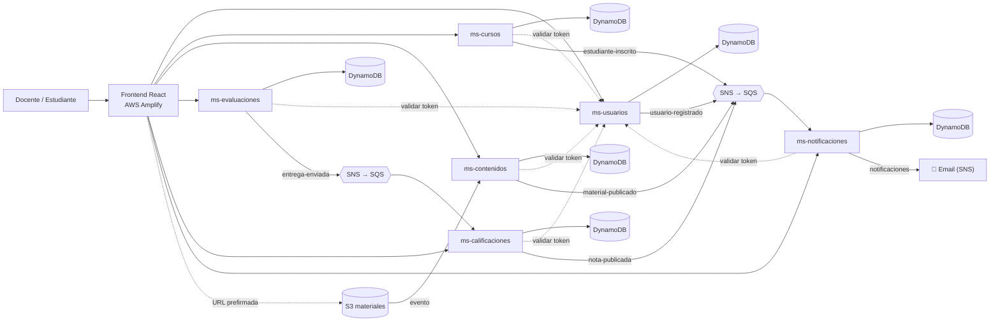

# ☁️ Nubeduca

**Tu institución educativa, en la nube.**

Nubeduca es un **LMS (Learning Management System) SaaS multi-tenant**: una sola plataforma que varias instituciones educativas usan al mismo tiempo, cada una con sus datos totalmente aislados. Proyecto Final del curso **CS2032 Cloud Computing (UTEC, 2026-2)**.

---

## 🎯 Qué hace

| Usuario | Puede |
|---|---|
| 👩‍🏫 **Docente** | Crear cursos, publicar materiales, crear evaluaciones (quizzes y tareas), calificar y ver el reporte de su curso |
| 🧑‍🎓 **Estudiante** | Inscribirse en cursos, revisar materiales, rendir evaluaciones y consultar sus notas y su progreso |
| 🏫 **Tenant** | Cada institución: `UTEC`, `UPC`, `PUCP` |

Cubre la definición de LMS del curso: **cursos, contenidos educativos, evaluaciones y seguimiento de estudiantes**.

---

## ✅ Requisitos del proyecto

- Arquitectura **multi-tenancy**, **serverless** y **basada en eventos (EDA)**.
- Mínimo **5 microservicios protegidos** (nosotros tenemos 6) (API Gateway + Lambda), cada uno con **su propia base de datos** (DynamoDB) y su **estructura JSON** documentada.
- **30,000 registros ficticios por microservicio**, divididos en **3 tenants**.
- Uso de **S3, SNS y SQS**.
- Todo el despliegue automatizado con **Serverless Framework**.
- **Frontend** en cualquier framework, desplegado en **AWS Amplify**.
- **Diagrama de arquitectura** y **demo con 2 tenants**.
- **Informe** (con enlaces públicos a los repos y diseño de BD de cada microservicio) y **PowerPoint**.

---

## 🏗️ Arquitectura

Cada microservicio = **API Gateway + Lambdas (Python) + DynamoDB**, desplegado con su propio `serverless.yml`.

### Flujos basados en eventos

1. **Docente sube un material** → llega a **S3** → evento → se publica `material-publicado` (**SNS**) → **SQS** de ms-notificaciones → **email** a los alumnos inscritos.
2. **Alumno rinde un quiz** → se publica `entrega-enviada` (**SNS**) → **SQS** de ms-calificaciones → se califica automáticamente → se publica `nota-publicada` → **SQS** de ms-notificaciones → **email** al alumno con su nota.

---

## 🧩 Repositorios

| Repo | Contenido |
|---|---|
| `nubeduca-ms-usuarios` | Registro, login, token y validación |
| `nubeduca-ms-cursos` | Cursos e inscripciones |
| `nubeduca-ms-contenidos` | Materiales del curso en S3 |
| `nubeduca-ms-evaluaciones` | Quizzes, tareas y entregas |
| `nubeduca-ms-calificaciones` | Notas, progreso y reportes |
| `nubeduca-ms-notificaciones` | Avisos por email y bandeja de notificaciones |
| `nubeduca-frontend` | Aplicación web en Amplify (todos aportan sus pantallas) |

---

## ⚖️ Cómo está dividido

Somos 6 y el proyecto tiene **6 microservicios**, así que **todos hacen exactamente lo mismo**, cada uno con su propio módulo:

| Cada integrante hace… | |
|---|---|
| 🛠️ **Backend** | 1 microservicio completo: API Gateway + Lambdas + DynamoDB, desplegado con Serverless Framework |
| 🖥️ **Frontend** | Las pantallas de su módulo dentro del frontend común (un solo repo en Amplify) |
| ⚡ **Eventos** | Publica y/o consume eventos SNS/SQS de su módulo |
| 🗃️ **Datos** | Su script de 30,000 registros (10,000 por tenant) y la estructura JSON de sus tablas |
| 📄 **Documentación** | Su sección del informe y sus diapositivas |
| 🎤 **Demo** | Presenta su módulo en la exposición |
| 🤝 **Tarea transversal** | Una tarea del grupo (ver la tabla de roles) |

Nadie hace solo backend o solo frontend: todos tocan las dos partes y todos tienen eventos.

---

## 👥 Roles — elige el tuyo

| Rol | Módulo | Tarea transversal | Elegido por |
|---|---|---|---|
| **1** | Usuarios y acceso | Base del frontend (layout, login, rutas) + despliegue en **Amplify** | |
| **2** | Cursos e inscripciones | Compilar el **informe** final | |
| **3** | Contenidos (S3) | **Diagrama de arquitectura** | |
| **4** | Evaluaciones y entregas | Compilar el **PowerPoint** final | |
| **5** | Calificaciones y seguimiento | **Despliegue final** de todo el backend en una sola cuenta AWS + colección Postman unificada | |
| **6** | Notificaciones | **Guion de la demo** con 2 tenants + video de respaldo | |

### Rol 1 — Usuarios y acceso · `nubeduca-ms-usuarios`

**Backend**
- [ ] Repo `nubeduca-ms-usuarios` y su `serverless.yml`.
- [ ] Tablas DynamoDB `t_usuarios` y `t_tokens_acceso`.
- [ ] Lambdas **registro** (estudiante, docente o admin, con contraseña encriptada) y **login** (genera el token con expiración).
- [ ] Lambda **validar token** (devuelve tenant, email y rol) y archivo `validar_token.py` para que lo usen los demás.
- [ ] Lambdas **perfil** y **listar usuarios**.

**Eventos**
- [ ] Publicar el evento SNS **usuario-registrado** (lo usa el rol 6 para el email de bienvenida).

**Frontend**
- [ ] Pantallas de **login** y **registro** con selección de institución (tenant), **perfil** y **administración de usuarios**.

**Datos y documentación**
- [ ] Script con 30,000 usuarios ficticios, estructura JSON, README, colección Postman, sección del informe y diapositivas.

**Transversal**
- [ ] **Base del frontend:** crear el repo `nubeduca-frontend`, el layout con menú, las rutas, el manejo del token y el cliente de API que usan todos. Desplegarlo en **AWS Amplify**.

### Rol 2 — Cursos e inscripciones · `nubeduca-ms-cursos`

**Backend**
- [ ] Repo `nubeduca-ms-cursos` y su `serverless.yml`.
- [ ] Tablas DynamoDB `t_cursos` y `t_inscripciones`.
- [ ] Lambdas **crear, listar, buscar, modificar y eliminar** cursos (solo el docente crea, modifica y elimina).
- [ ] Lambdas **inscribir**, **mis cursos** e **inscritos** de un curso.
- [ ] Proteger las Lambdas con el token.

**Eventos**
- [ ] Publicar el evento SNS **estudiante-inscrito** (lo usa el rol 6 para saber a quién avisar).

**Frontend**
- [ ] Pantallas de **catálogo de cursos**, **crear/editar curso** (docente), **inscribirse** y **mis cursos**, y lista de **inscritos**.

**Datos y documentación**
- [ ] Script con 30,000 cursos ficticios, estructura JSON, README, colección Postman, sección del informe y diapositivas.

**Transversal**
- [ ] **Informe:** preparar la plantilla, recibir las secciones de todos y compilar el documento final.

### Rol 3 — Contenidos · `nubeduca-ms-contenidos`

**Backend**
- [ ] Repo `nubeduca-ms-contenidos` y su `serverless.yml`.
- [ ] Bucket **S3** de materiales y tabla DynamoDB `t_contenidos`.
- [ ] Lambda **subir material** (devuelve una URL prefirmada de S3; solo docente).
- [ ] Lambdas para registrar **enlaces** (videos o links), **listar**, **descargar** (URL prefirmada) y **eliminar**.
- [ ] Proteger las Lambdas con el token.

**Eventos**
- [ ] Lambda disparada por el **evento de S3**: marca el material como publicado y envía el evento SNS **material-publicado** (lo usa el rol 6).

**Frontend**
- [ ] Pantallas de **materiales del curso por semana**, **subir material** (docente) y **descargar/ver** material.

**Datos y documentación**
- [ ] Script con 30,000 contenidos ficticios, estructura JSON, README, colección Postman, sección del informe y diapositivas.

**Transversal**
- [ ] **Diagrama de arquitectura** de toda la solución (draw.io con íconos AWS).

### Rol 4 — Evaluaciones y entregas · `nubeduca-ms-evaluaciones`

**Backend**
- [ ] Repo `nubeduca-ms-evaluaciones` y su `serverless.yml`.
- [ ] Tablas DynamoDB `t_evaluaciones` y `t_entregas`.
- [ ] Lambdas **crear, listar, buscar, modificar y eliminar** evaluaciones (quizzes y tareas; solo el docente crea, modifica y elimina).
- [ ] Ocultar las respuestas correctas cuando consulta un estudiante.
- [ ] Lambdas **entregar** (estudiante, valida fecha límite) y **ver entregas** (docente).
- [ ] Proteger las Lambdas con el token.

**Eventos**
- [ ] Publicar el evento SNS **entrega-enviada** al recibir una entrega (lo usa el rol 5 para calificar).

**Frontend**
- [ ] Pantallas de **crear evaluación** (docente, con preguntas), **rendir quiz** y **entregar tarea** (estudiante), y **ver entregas** (docente).

**Datos y documentación**
- [ ] Script con 30,000 evaluaciones ficticias, estructura JSON, README, colección Postman, sección del informe y diapositivas.

**Transversal**
- [ ] **PowerPoint:** preparar la plantilla, recibir las diapositivas de todos y compilar la presentación final.

### Rol 5 — Calificaciones y seguimiento · `nubeduca-ms-calificaciones`

**Backend**
- [ ] Repo `nubeduca-ms-calificaciones` y su `serverless.yml`.
- [ ] Tabla DynamoDB `t_calificaciones`.
- [ ] Lambda **calificar** tareas manualmente (docente).
- [ ] Lambdas **mis notas** y **progreso** del estudiante, y **reporte del curso** para el docente (promedio, aprobados, desaprobados).
- [ ] Proteger las Lambdas con el token.

**Eventos**
- [ ] Lambda que escucha (SQS) **entrega-enviada** y califica los quizzes automáticamente.
- [ ] Publicar el evento SNS **nota-publicada** (lo usa el rol 6 para avisar al estudiante).

**Frontend**
- [ ] Pantallas de **mis notas** y **progreso** (estudiante), **calificar tareas** y **reporte del curso** (docente).

**Datos y documentación**
- [ ] Script con 30,000 calificaciones ficticias, estructura JSON, README, colección Postman, sección del informe y diapositivas.

**Transversal**
- [ ] **Despliegue final** de los 6 microservicios en una sola cuenta AWS y **colección Postman unificada** del proyecto.

### Rol 6 — Notificaciones · `nubeduca-ms-notificaciones`

**Backend**
- [ ] Repo `nubeduca-ms-notificaciones` y su `serverless.yml`.
- [ ] Tablas DynamoDB `t_notificaciones` y `t_destinatarios` (copia de los inscritos por curso, armada a partir de los eventos).
- [ ] Lambdas **mis notificaciones** y **marcar como leída**.
- [ ] Topic SNS **notificaciones** con suscripción por email.
- [ ] Proteger las Lambdas con el token.

**Eventos**
- [ ] Lambdas que escuchan (SQS) los eventos **usuario-registrado** (email de bienvenida), **estudiante-inscrito** (guarda al destinatario), **material-publicado** (avisa a los inscritos del curso) y **nota-publicada** (avisa al estudiante).

**Frontend**
- [ ] **Campana / bandeja de notificaciones** en el menú, con contador de no leídas.

**Datos y documentación**
- [ ] Script con 30,000 notificaciones ficticias, estructura JSON, README, colección Postman, sección del informe y diapositivas.

**Transversal**
- [ ] **Guion de la demo** con 2 tenants (quién presenta cada parte) y **video de respaldo**.

---

## 🎯 Primera presentación con el asesor (avance del 30%)

La rúbrica le da **3 puntos** a esta exposición virtual y pide un **avance proporcional al 30%**.

**Lo que debe verse como grupo**
- [ ] Idea del SaaS (LMS multi-tenant) y los 6 módulos.
- [ ] **Diagrama de arquitectura v1** (rol 3).
- [ ] Los **6 microservicios desplegados** con Serverless Framework, cada uno con su CRUD principal funcionando en Postman.
- [ ] Las **6 tablas con 30,000 registros** repartidos en UTEC, UPC y PUCP.
- [ ] **Frontend base publicado en Amplify** con login (rol 1).
- [ ] **Diapositivas del avance** (rol 4 las junta; cada uno aporta 1).

**Lo que queda para después del avance (el 70% restante):** proteger todas las APIs con el token, conectar los eventos entre módulos, completar las pantallas del frontend, el despliegue final en una sola cuenta, el informe, el PowerPoint final y la demo con 2 tenants.

---

## ⚡ Eventos entre módulos

| Evento (SNS → SQS) | Lo publica | Lo consume |
|---|---|---|
| `usuario-registrado` | Rol 1 | Rol 6 |
| `estudiante-inscrito` | Rol 2 | Rol 6 |
| `material-publicado` | Rol 3 (desde el evento de S3) | Rol 6 |
| `entrega-enviada` | Rol 4 | Rol 5 |
| `nota-publicada` | Rol 5 | Rol 6 |

Mientras un módulo no esté listo, quien consume su evento lo puede **simular** con `aws sns publish` y el JSON acordado, así nadie espera a nadie.

---

## 📐 Reglas comunes (para todos)

- Repos **públicos** dentro de la organización `nubeduca`.
- **Python 3.13** + **Serverless Framework** (`sls deploy`).
- Rol IAM: `arn:aws:iam::${aws:accountId}:role/LabRole`.
- Tablas: `${sls:stage}-t_<nombre>`, con **`tenant_id` en la clave de partición**.
- Tenants: `UTEC`, `UPC`, `PUCP` · Roles de usuario: `STUDENT`, `TEACHER`, `ADMIN`.
- Todas las APIs (menos registro y login) se **protegen con el token** del rol 1, y el `tenant_id` se toma **del token**.
- Logs en formato estándar: `{"tipo": "INFO" | "ERROR", "log_datos": {...}}`.
- Cada repo incluye: `serverless.yml`, Lambdas, `poblar_datos.py` (30,000 registros), colección de Postman y README con la estructura JSON de sus tablas.
- En el frontend, cada uno trabaja en su propia carpeta de pantallas (`src/modulos/<su-modulo>`) para no pisarse.
- Cada uno envía su sección del informe al rol 2 y sus diapositivas al rol 4.
